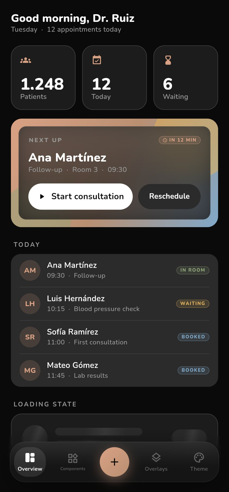
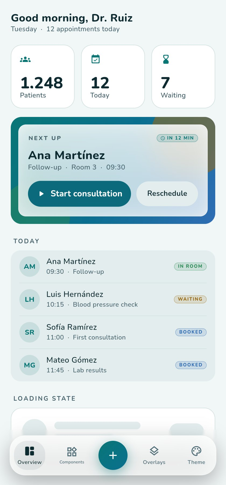
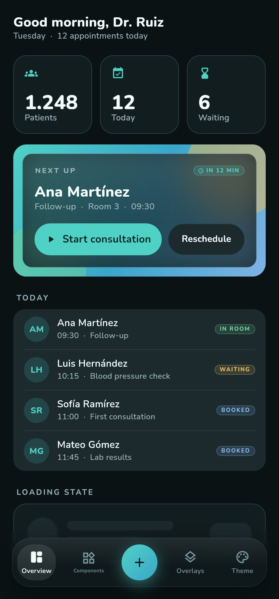
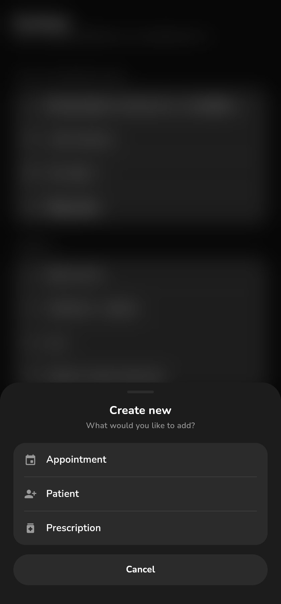
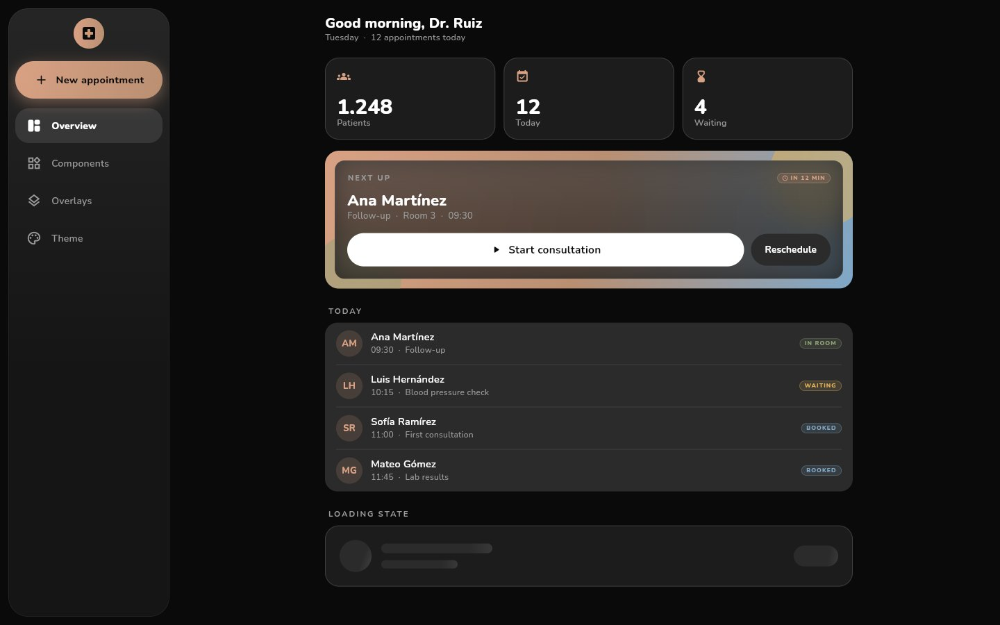
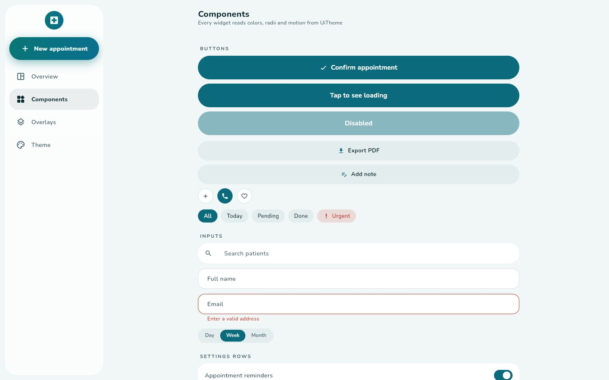
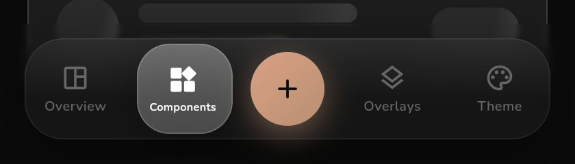

# flutter_ui_theme

A plug-and-play Flutter design system: frosted-glass surfaces, a liquid
navigation bar, springy pill buttons, directional screen transitions and toasts.
One `UiTheme` object drives every color, radius, font, shadow and animation, so the
same look can be re-branded in a few lines.

It also builds a complete Material 3 `ThemeData`, so an existing app changes its
look **before** any screen is rewritten.

Runs on Android, iOS, macOS, Windows, Linux and web (Flutter 3.35+).

<p>
  
  
  
  
</p>
<p>
  
  
</p>
<p></p>

## Quick start

```yaml
dependencies:
  flutter_ui_theme:
    git:
      url: https://github.com/carlosupreme/flutter-ui-theme
```

```dart
import 'package:flutter/material.dart';
import 'package:flutter_ui_theme/flutter_ui_theme.dart';

void main() => runApp(MaterialApp(
      theme: buildUiTheme(UiTheme.light),
      darkTheme: buildUiTheme(UiTheme.dark),
      home: Scaffold(
        body: UiShell(
          items: const [
            UiNavItem(icon: Icons.home_outlined, activeIcon: Icons.home_rounded, label: 'Home'),
            UiNavItem(icon: Icons.people_outline, activeIcon: Icons.people_rounded, label: 'Patients'),
          ],
          selectedIndex: 0,
          onSelected: (_) {},
          body: ListView(children: [
            UiPrimaryButton(label: 'Book appointment', onPressed: () {}),
          ]),
        ),
      ),
    ));
```

Re-brand it:

```dart
final brand = UiTheme.light.copyWith(
  colors: UiColors.light.copyWith(primary: const Color(0xFF0B6B7C), accent: const Color(0xFF097676)),
  shape: const UiShape(card: 16),
  typography: const UiTypography(family: 'Inter', package: null),
);
MaterialApp(theme: buildUiTheme(brand));
```

## What is inside

| Area | Widgets |
|---|---|
| **Tokens** | `UiTheme`, `UiColors` (light, dark, AMOLED), `UiShape`, `UiMotion`, `UiTypography` (Nunito bundled), `UiEffects`, `buildUiTheme` |
| **Buttons** | `UiPrimaryButton` (loading and disabled states), `UiSecondaryButton`, `UiPill`, `UiRoundButton`, `UiSegmentedToggle`, `UiSwitch`, `UiStepper`, `UiPressable` |
| **Navigation** | `UiShell` (bottom bar on phones, side rail on desktop), `UiNavBar` (glass, liquid pill, drag-to-select, badges, center action), `UiNavRail` |
| **Transitions** | `UiScreenSwitcher`, `UiPageTransitionsBuilder` (auto-installed by `buildUiTheme`), `Rise` / `riseAll` staggered entrances |
| **Surfaces** | `UiCard`, `UiGlassSurface`, `UiBadge`, `UiShimmer`, `UiPatternBackground`, `UiSheetHandle` / `UiSheetTitle` |
| **Lists and inputs** | `UiOptionGroup`, `UiListGroup`, `UiSearchField`, `UiScreenHeader`, `UiMarqueeText`, `UiRollingText` |
| **Overlays** | `showUiSheet` (centered panel on wide windows), `showUiDialog`, `showUiConfirm`, `showUiToast`, `UiEdgeBlur` |
| **Stock widgets, restyled** | buttons, inputs, switches, checkboxes, chips, cards, dialogs, bottom sheets, date and time pickers, menus, tooltips, snack bars, scrollbars, tabs |

See `AGENTS.md` for the migration playbook and the Material-to-`Ui*` mapping table.

## Run the gallery

```bash
cd example
flutter create --platforms=macos,windows,android,web .   # generated folders are git-ignored
flutter run -d macos          # or windows, android, chrome
```

On web, the URL selects the state: `?mode=light|dark|amoled&brand=original|clinic&tab=0..3`.

## Develop

```bash
flutter pub get
flutter analyze
flutter test        # 55 widget and unit tests
```

## Credits and license

The visual design, motion and component implementations are adapted from
**GymMane** by InlitX (https://github.com/InlitX/GymMane), whose author has
allowed the UI to be reused. The Nunito font is licensed under the SIL Open Font
License 1.1 (`fonts/Nunito-OFL.txt`). Details in [NOTICE.md](NOTICE.md).

This repository does not declare a license yet; choose one before publishing it
or distributing the clinic app (see NOTICE.md).
